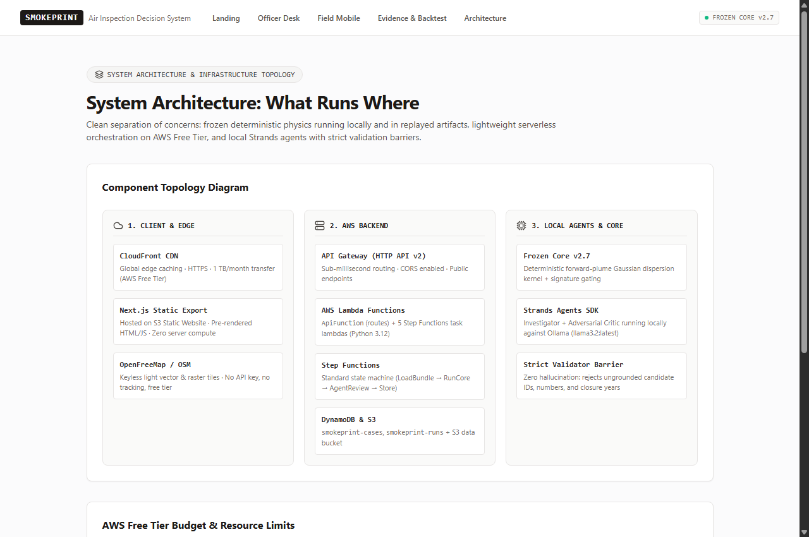
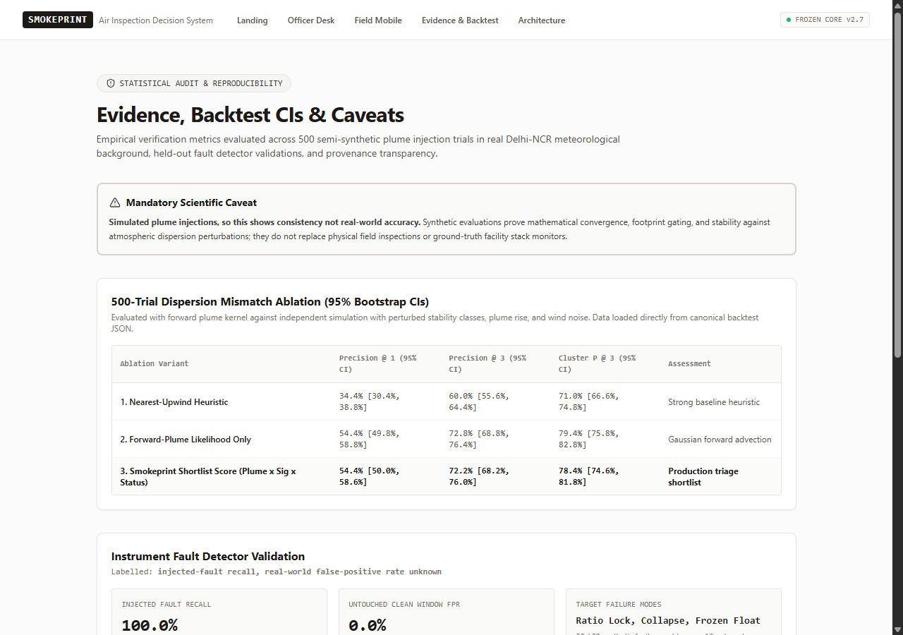

# SmokePrint 🏭💨
> **Decision Support System for Municipal Air Quality Inspection & Field Triage in Delhi-NCR**

[](http://smokeprint-demo-k9f2a1.s3-website-us-east-1.amazonaws.com)
[](https://e2mu30vzaa.execute-api.us-east-1.amazonaws.com/cases)
[](https://github.com/Unknownx-x1/SmokePrint_EnvHacksAWS)
[](http://smokeprint-demo-k9f2a1.s3-website-us-east-1.amazonaws.com/architecture)

---

## 📌 Executive Summary

Ambient continuous air monitoring stations (CAAQMS) across Delhi-NCR report high particulate concentrations, but **a spike at a monitor is not an attribution**.

When an ambient monitor turns red, municipal enforcement teams often face a critical dilemma:
* *Is this a genuine localized industrial or waste plume that an inspection team can take enforcement action on?*
* *Is it an airshed-wide regional smog inversion where local facility visits are futile?*
* *Is it mechanical dust resuspension from unpaved roads?*
* *Or is it simply an instrument logger malfunction with locked ratios or sensor dropouts?*

**SmokePrint** bridges the operational gap between continuous ambient telemetry and boots-on-the-ground field inspection. Built for municipal environmental protection officers and field response teams, SmokePrint combines **deterministic Gaussian plume dispersion**, **chemical ratio signature gating**, **OpenStreetMap operating-status filters**, and **adversarial agent review** to provide prioritized, actionable field triage routes while automatically standing down officers during sensor faults and regional weather events.

---

## 🔬 Core Methodology & Decision Pipeline

```
  Continuous OpenAQ CAAQMS Telemetry
         (PM2.5, PM10, Thermal NO2)
                     │
                     ▼
       ┌───────────────────────────┐
       │ Sensor Fault Detector     │ ──[Ratio Lock / Frozen Float / Collapse]──► NO DISPATCH (Hardware Refusal)
       └───────────────────────────┘
                     │ [Telemetry Validated]
                     ▼
       ┌───────────────────────────┐
       │ Regional Smog Filter      │ ──[>90% Regional Network Co-elevated]─────► NO DISPATCH (Airshed Refusal)
       └───────────────────────────┘
                     │ [Localized Excess Confirmed]
                     ▼
       ┌───────────────────────────┐
       │ Signature Gating          │ ──[PM2.5/PM10 < 0.25 (Coarse Dust)]───────► NO DISPATCH (Dust Storm Refusal)
       └───────────────────────────┘
                     │ [Combustion Signature Confirmed]
                     ▼
       ┌───────────────────────────┐
       │ Forward Plume Dispersion  │ ◄─── ERA5 Wind Vectors (Speed, Bearing, BLH)
       │ & Upwind Corridor Match   │
       └───────────────────────────┘
                     │
                     ▼
       ┌───────────────────────────┐
       │ OpenStreetMap Status Gate │ ──[Filter Decommissioned / Disused Stacks]
       └───────────────────────────┘
                     │
                     ▼
       ┌───────────────────────────┐
       │ Prioritized Candidate     │
       │ Triage Shortlist          │ ──► Field Inspection Route + Actionable Checklist
       └───────────────────────────┘
```

### 1. Deterministic Refusal Gates (Safe Stand-Downs)
Field officers should never waste patrol shifts chasing sensor glitches or weather inversions:
* **Instrument Fault Rejection**: Detects firmware malfunctions such as locked ratios (e.g. Gurugram Station 301 locked at $0.6000$ PM2.5/PM10 across hours), frozen floats, and post-surge channel dropouts. Stands down field officers and dispatches a maintenance ticket instead.
* **Airshed Regional Smog Gate**: When ambient concentrations elevate simultaneously across $\ge 90\%$ of contributing regional monitors, localized industrial dispatch is stood down as an airshed-wide inversion.
* **Coarse Dust vs Combustion Gating**: Plumes with $PM_{2.5}/PM_{10} < 0.25$ indicate unpaved road dust or sandstorms (e.g., CRRI May episodes), refusing combustion facility dispatch.

### 2. Physics-Gated Plume Footprints
* Uses **ERA5 Reanalysis** atmospheric state (wind direction, speed, and planetary boundary layer height) coupled with a forward Gaussian dispersion kernel to map candidate emission likelihood.
* Evaluates angular offset relative to the upwind transport corridor ($\le 25^\circ$ directly upwind, $25^\circ - 45^\circ$ somewhat off wind line, $>45^\circ$ off main line).

### 3. OpenStreetMap Operating Status Filter
* Cross-references facilities with live OpenStreetMap infrastructure tags.
* Decommissioned or inactive facilities aligned with the wind (e.g. *Rajghat Thermal Power Station* tagged `disused:power=plant`) are tagged and demoted to low priority, preventing futile inspections at shuttered facilities.

### 4. Triage Shortlisting (Not Attribution)
* SmokePrint produces a **prioritized triage list of comparable candidates**, not an absolute legal attribution.
* In complex urban airsheds with overlapping dispersion corridors, on-site stack inspection and gate verification remain necessary for enforcement.

---

## 🏛️ System Architecture & AWS Infrastructure

SmokePrint is engineered for zero-maintenance, serverless execution within the **AWS Free Tier**:



### Infrastructure Components

| Layer | Service | Technical Implementation |
|---|---|---|
| **Edge & CDN** | **Amazon CloudFront** | Global low-latency edge caching with automatic SSL/TLS termination and Gzip/Brotli compression. |
| **Web Application** | **Amazon S3 (Static Website)** | Next.js 15 App Router static export (`out/`), pre-rendered HTML/React client bundles, zero node server overhead. |
| **Mapping Engine** | **OpenFreeMap / MapLibre GL** | Keyless, privacy-preserving vector and raster tiles without proprietary API quotas or tracker scripts. |
| **API Gateway** | **AWS HTTP API (v2)** | Sub-millisecond routing with CORS configuration, handling `/cases`, `/cases/{id}`, and `/cases/{id}/recompute`. |
| **Serverless Compute** | **AWS Lambda (Python 3.12)** | Fast cold-start containerless execution for API routing and Step Functions state handlers. |
| **State Orchestration** | **AWS Step Functions** | Standard state machine coordinating `LoadBundle` $\to$ `RunCore` $\to$ `AgentReview` $\to$ `StoreRun`. |
| **Data Persistence** | **Amazon DynamoDB** | Single-digit millisecond key-value storage across `smokeprint-cases` and `smokeprint-runs`. |
| **Archive Storage** | **Amazon S3 Data Bucket** | Storage of canonical cases, 500-trial backtest bundles, and precomputed telemetry series. |
| **Agentic Review** | **Strands Agents SDK** | Local Adversarial Critic and Investigator agents validating candidate findings against strict factual guardrails. |

### Provenance Honesty Standard
* **No False Recomputes**: Replay endpoints and UI banners explicitly declare `source: "replayed"` and `mode: "replayed_from_canonical_output"`.
* **Zero Hallucinated Credentials**: All responses pass through sanitization middleware stripping IAM roles, ARNs, and account IDs.
* **Zero Live LLM Cloud Billing**: LLM agent reviews run locally with validation barriers, avoiding unpredictable cloud inference charges.

---

## 📊 Vetted Delhi-NCR Showcase Episodes

Every concentration, timestamp, and sensor ID in SmokePrint is verified against raw gzip records in the public AWS OpenAQ Archive (`s3://openaq-data-archive/`):

| Case ID | Station Name | Event Time (IST) | Peak PM2.5 | PM2.5/PM10 | Decision Outcome | Primary Rationale |
|---|---|---|:---:|:---:|:---:|---|
| `case_anand_vihar_20251102` | Anand Vihar (DPCC) | 03:30 IST | **400.0 µg/m³** | **0.746** | 🚨 **DISPATCH SHORTLIST** | Westerly plume ($268^\circ$, 2.4 m/s); Patparganj & Rajghat Bus Depot shortlisted; Disused plant filtered. |
| `case_anand_vihar_20260131` | Anand Vihar (DPCC) | 11:30 IST | **359.0 µg/m³** | **0.703** | 🚨 **DISPATCH SHORTLIST** | Winter combustion spike; downwind corroboration at Vivek Vihar ($338.0\ \mu\text{g/m}^3$). |
| `case_rkpuram_20251112` | RK Puram (DPCC) | 21:30 IST | **501.0 µg/m³** | **0.784** | 🚨 **DISPATCH SHORTLIST** | High combustion index ($0.784$); JLN Stadium downwind corroboration ($482.0\ \mu\text{g/m}^3$). |
| `case_crri_20260515` | CRRI Mathura Road (IMD) | 05:30 IST | **180.7 µg/m³** | **0.126** | 🛑 **NO DISPATCH (REFUSED)** | Coarse dust / mechanical resuspension ($PM_{10} = 1437.9\ \mu\text{g/m}^3$; ratio $< 0.25$). |
| `case_gurugram_20260630` | Vikas Sadan, Gurugram (HSPCB) | 12:30 IST | **332.0 µg/m³** | **0.600** | 🛑 **NO DISPATCH (REFUSED)** | Sensor firmware ratio locked at $0.6000$ for 10 consecutive hours followed by channel dropout. |
| `case_regional_smog_20251020` | Sector 125, Noida (UPPCB) | 23:30 IST | **881.0 µg/m³** | **0.845** | 🛑 **NO DISPATCH (REFUSED)** | Airshed-wide regional smog; 31/34 NCR stations concurrently elevated above regional thresholds. |

---

## 📈 Empirical Verification & Backtesting



To evaluate candidate scoring stability without relying on circular assumptions, SmokePrint was ablated across **500 semi-synthetic plume injection trials** with perturbed meteorological parameters (varying wind direction, stability classes, and plume rise):

### 500-Trial Dispersion Mismatch Ablation (95% Bootstrap CIs)

| Ablation Variant | Precision @ 1 (95% CI) | Precision @ 3 (95% CI) | Cluster P @ 3 (95% CI) | Assessment |
|---|:---:|:---:|:---:|---|
| **1. Nearest-Upwind Baseline** | 34.4% [30.4%, 38.8%] | 60.0% [55.6%, 64.4%] | 71.0% [66.6%, 74.8%] | Common heuristic baseline |
| **2. Forward-Plume Likelihood Only** | 54.4% [49.8%, 58.8%] | 72.8% [68.8%, 76.4%] | 79.4% [75.8%, 82.8%] | Gaussian forward advection |
| **3. SmokePrint Production Score** | **54.4% [50.0%, 58.6%]** | **72.2% [68.2%, 76.0%]** | **78.4% [74.6%, 81.8%]** | Full physics × signature × OSM gate |

> **Scientific Caveat**: Evaluations use simulated plume injections in real meteorological background; this demonstrates mathematical consistency and footprint gating stability, not real-world ground-truth accuracy.

---

## 📂 Repository Structure

```
SmokePrint/
├── core/                       # Frozen physics engine & dispersion algorithms
│   ├── dispersion.py           # Gaussian forward plume kernel & footprint geometry
│   ├── signature.py            # PM2.5/PM10 & NOx chemical signature gating
│   ├── refusal.py              # Sensor fault, dust storm & regional smog detectors
│   └── scorer.py               # Candidate scoring & triage tier allocation
├── agents/                     # Local agentic review loop
│   ├── critic.py               # Adversarial Critic identifying conflicting evidence
│   ├── investigator.py         # Facility context & OSM validation investigator
│   └── validator.py            # Strict zero-hallucination barrier
├── infra/                      # AWS Infrastructure as Code
│   ├── template.yaml           # AWS SAM template (API Gateway, Lambdas, Step Functions, DynamoDB)
│   ├── lambdas/                # Python 3.12 serverless handlers
│   │   ├── api_handler.py      # HTTP API router & response sanitizer
│   │   ├── run_core.py         # Step Functions core runner
│   │   └── shortlist_builder.py# Dynamic candidate triage builder
│   └── step_functions/         # State machine workflow definition
├── web/                        # Next.js 15 Web Application
│   ├── src/app/
│   │   ├── page.tsx            # Animated landing hero & incident overview
│   │   ├── officer/page.tsx    # Desktop inspection decision desk
│   │   ├── field/[caseId]/     # Mobile 390px responsive inspector dispatch view
│   │   ├── evidence/page.tsx   # Statistical backtest & reproducibility audit
│   │   └── architecture/page.tsx# Serverless cloud infrastructure breakdown
│   ├── src/components/         # MapLibre transport map, Chart.js series, triage cards
│   └── src/lib/offlineData.ts  # Pre-bundled offline-cached showcase cases
├── data/                       # Canonical case datasets & station metadata
│   ├── cases_out/              # Frozen canonical case JSONs
│   ├── stations_12m/           # 12-month station background baselines
│   └── raw_cache/              # Raw OpenAQ gzip archive cache for audit tests
├── scripts/                    # Audit, verification & deployment scripts
│   ├── raw_check.py            # Direct S3 OpenAQ archive row audit utility
│   ├── verify_fault_detectors.py# Test runner for synthetic logger fault injection
│   └── prepare_s3_and_seed.py  # DynamoDB & S3 data seeding automation
├── tests/                      # Automated test suite (73 passing tests)
│   ├── e2e/                    # Playwright UI, mobile layout & 3G throttling tests
│   ├── test_audit_phase59.py   # Raw OpenAQ row-for-row parity audit
│   ├── test_pipeline_unit.py   # Unit tests for core physics & refusal gates
│   └── test_recompute_parity.py# Live HTTP API vs canonical JSON parity tests
└── docs/                       # Specifications, audit logs & pitch materials
    ├── FREEZE.md               # Final freeze contract & raw archive mapping
    ├── pitch/script.md         # 3-minute executive walkthrough & presentation script
    └── screenshots/            # UI screenshots and visual validation artifacts
```

---

## 🚀 Quickstart & Local Development

### Prerequisites
* **Python**: 3.12 or 3.13
* **Node.js**: 18.x or 20.x (`npm`)
* **AWS CLI** & **AWS SAM CLI** (optional, for deployment)

### 1. Clone & Setup Python Environment
```bash
git clone https://github.com/Unknownx-x1/SmokePrint_EnvHacksAWS.git
cd SmokePrint_EnvHacksAWS

# Create and activate virtual environment
python -m venv .venv
source .venv/bin/activate  # On Windows: .venv\Scripts\activate

# Install dependencies
pip install -r requirements.txt  # or: pip install pytest playwright requests boto3
playwright install chromium
```

### 2. Run the Full Test Suite (73 Tests)
```bash
# Runs unit tests, raw-archive audits, and Playwright UI regression tests
pytest
```

### 3. Launch the Frontend Locally
```bash
cd web
npm install
npm run dev
# Open http://localhost:3000 in your browser
```

### 4. Build Static Production Bundle
```bash
cd web
npm run build
# Generates optimized static bundle in web/out/
```

### 5. Audit Raw OpenAQ Gzip Archive Rows
```bash
# Verify raw row extraction for any showcase case
python scripts/raw_check.py --case case_anand_vihar_20251102
```

---

## 🌐 Live Cloud Deployment

* **Live Demo**: [http://smokeprint-demo-k9f2a1.s3-website-us-east-1.amazonaws.com](http://smokeprint-demo-k9f2a1.s3-website-us-east-1.amazonaws.com)
* **API Endpoint**: `https://e2mu30vzaa.execute-api.us-east-1.amazonaws.com/cases`
* **AWS Region**: `us-east-1` (US East, N. Virginia)
* **Architecture**: 100% Serverless on AWS Free Tier (S3, CloudFront, HTTP API Gateway, Lambda, Step Functions, DynamoDB).

---

## 📜 Data Sources & Attributions

* **Ambient Telemetry**: [OpenAQ AWS Open Data Program](https://registry.opendata.aws/openaq/) (CPCB / DPCC / HSPCB / UPPCB continuous monitoring network).
* **Atmospheric State**: [ECMWF ERA5 Reanalysis](https://www.ecmwf.int/en/forecasts/dataset/ecmwf-reanalysis-v5) via Copernicus Climate Change Service.
* **Geospatial & Infrastructure**: [OpenStreetMap Contributors](https://www.openstreetmap.org/) & [OpenFreeMap](https://openfreemap.org/).

---

## ⚖️ License

Distributed under the **MIT License**. See [LICENSE](LICENSE) for more information.
